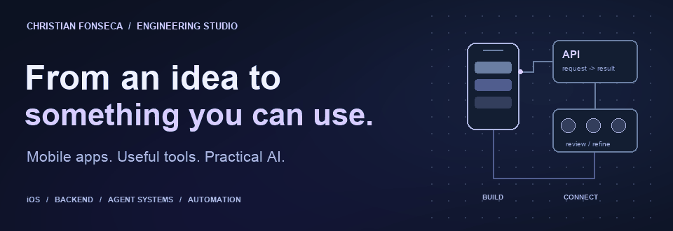
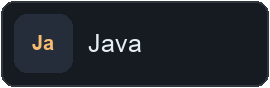
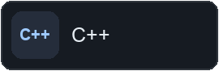
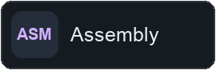
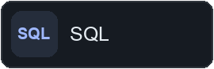
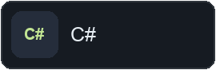

<picture>
  <source media="(prefers-reduced-motion: reduce)" srcset="assets/profile-banner.png" />
  
</picture>

**iOS developer / Backend builder / Applied AI**

# Hi, I'm Christian.

I turn ideas into tools I want to use—from an AI-powered fitness app to workspaces that coordinate AI agents.

**San Francisco Bay Area · Interested in software engineering opportunities and collaboration**

---

## What I'm building right now

A snapshot of my workbench · November 2026

| Project | Current focus |
| --- | --- |
| **VyraAI** · Mobile product | Refining the iOS experience, coaching workflows, localization, and testing. |
| **AI Harness** · Agent orchestration | Coordinating coding agents with durable tasks, isolated workspaces, and review gates. |
| **AI City** · Interactive prototype | Building a pixel-art workspace for agent tasks and approvals. Live execution remains disabled. |

---

## Languages I work with

  
  
  
  
  
  
  
  

**Automation:** Google Apps Script

---

## Selected work

### VyraAI
**A more thoughtful fitness and nutrition experience for iOS.**

My flagship product brings meal tracking, food scanning, and health data into a cohesive mobile experience. I work across the interface, app architecture, AI integrations, and backend.

- **The idea:** make fitness and nutrition tracking feel like one thoughtful experience.
- **The engineering:** connect SwiftUI, HealthKit, food scanning, and a Supabase backend.
- **The next chapter:** keep improving coaching flows, localization, and regression coverage.

`Swift` `SwiftUI` `HealthKit` `Vision / OCR` `Supabase`

[Product support ↗](https://christfg1.github.io/vyraai-support/) · [Privacy policy ↗](https://github.com/Christfg1/vyraai-privacy-policy)

VyraAI’s application source is private.

### EasyShop API
**An e-commerce backend built around authentication, clear layers, and persistent data.**

From a product search to a completed checkout: a Java and Spring Boot API with JWT authentication, role-based access, and MySQL persistence.

**Engineering focus:** clear controller, service, and repository boundaries.

`Java` `Spring Boot` `Spring Security` `MySQL` `JPA`

[Explore the repository ↗](https://github.com/Christfg1/capstone-3-ecommerce-api)

### WbridgeM
**Connecting a Mac and Windows PC over a local network.**

Built around a practical question: how can a Mac and Windows PC work better together? A SwiftUI client and .NET host connect file transfers, clipboard sync, and desktop control over the local network.

**Engineering focus:** native platform integration and HTTP/WebSocket communication.

`SwiftUI` `C#` `.NET` `WebSockets`

[Explore the repository ↗](https://github.com/Christfg1/WbridgeM)

---

## Frameworks, platforms & tools

| Mobile & product | Backend & data | AI & automation |
| --- | --- | --- |
| SwiftUI · HealthKit | Spring Boot · .NET | AI integrations · OCR |
| Vision · Xcode | Supabase · MySQL | Google Apps Script |
| UI design | REST APIs · Authentication | Git · GitHub |

<strong>Also in my project lab — Keepsake & Fonari SiteScore</strong>

### Keepsake

An internship work companion for capturing work, organizing projects, and turning reflections into evidence of growth.

### Fonari SiteScore

A website audit and CRM workspace connecting evidence-backed assessments, opportunities, follow-ups, and reviewable AI drafts.

## The thread connecting my work

I enjoy making complicated workflows feel easier to use. My projects combine **product design, mobile development, backend systems, and practical AI**—with an emphasis on clear boundaries and work I can review and improve.

---

### Let's build something useful.

Interested in collaborating on an iOS app, a backend service, or an AI-powered product?

[Find me on GitHub ↗](https://github.com/Christfg1)
